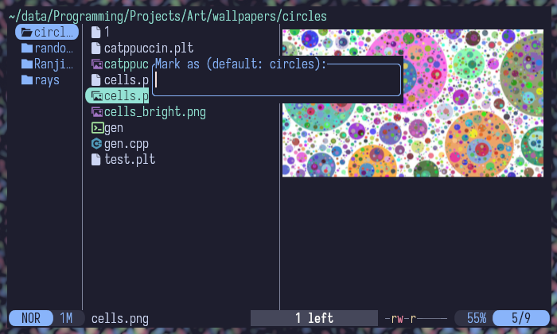
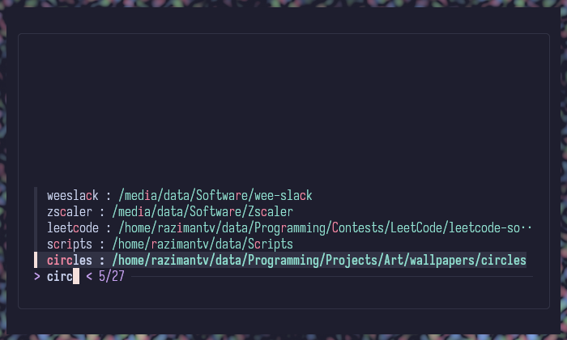

# fzf-marks.yazi

A [Yazi](https://yazi-rs.github.io/) plugin that brings
[fzf-marks](https://github.com/urbainvaes/fzf-marks)-style bookmark jumping
into Yazi itself: Fuzzy-find a saved bookmark and jump straight to it without
leaving the file manager.

It reads and writes the same `$FZF_MARKS_FILE` (default to `~/.fzf-marks`) the
original `fzf-marks` uses, so the two are interchangeable: keep using
`fzm`/`mark` at the shell if you like, or manage marks entirely from inside
Yazi.

## Features

- **Jump to a mark**: fuzzy-filter your bookmarks with `fzf` and `cd`  to
  whichever one you pick.
- **Delete a mark with `Ctrl-D`** from inside the picker: comments, blank
  lines, and anything else in your marks file that isn't a recognized mark are
  left untouched. order.
- **Add a mark** from a separate keybinding: prompts for a label (defaulting
  to the current directory's name if you just hit Enter) and appends it to
  your marks file.
- Filter text is preserved across a delete, so removing several marks that
  match the same search doesn't make you retype the query each time.

Not all of fzf-marks' functionality is implemented yet.

## Requirements

- [Yazi](https://yazi-rs.github.io/), a reasonably recent version.
- [`fzf`](https://github.com/junegunn/fzf) on your `PATH`.

The original `fzf-marks` shell tool is **not** required. This plugin reads and
writes its file format directly

## Installation

Using Yazi's plugin manager:

```sh
ya pkg add razimantv/fzf-marks
```

Or manually:

```sh
# Linux / macOS
git clone https://github.com/razimantv/fzf-marks.yazi ~/.config/yazi/plugins/fzf-marks.yazi

# Windows
git clone https://github.com/razimantv/fzf-marks.yazi %AppData%\yazi\config\plugins\fzf-marks.yazi
```

## Configuration

Add keybindings to `keymap.toml` in the [configuration
directory](https://yazi-rs.github.io/docs/configuration/overview):

```toml
[[mgr.prepend_keymap]]
on   = "'"
run  = "plugin fzf-marks"
desc = "Jump to an fzf-marks bookmark"

[[mgr.prepend_keymap]]
on   = "m"
run  = "plugin fzf-marks -- add"
desc = "Add current directory as an fzf-marks bookmark"
```

`'`/`m` are just suggestions, pick whatever doesn't collide with the rest of
your keymap. If you're replacing Yazi's built-in zoxide binding, `Z` (its
default slot) is another natural choice for the jump command.

## Usage

| Add a mark | Jump to a mark |
|------------|----------------|
|  |  |

- Invoke the add keybinding to bookmark the current directory. Leave the
  prompt empty and confirm to use the directory's own name as the label.
- Invoke the jump keybinding, type to fuzzy-filter, and press **Enter** to
  jump to the highlighted mark.
- Press **Ctrl-D** to delete the highlighted mark instead. The list
  refreshes in place so you can continue without reopening the plugin.
- **Esc**/**Ctrl-C** cancels without changing anything.

## Marks file format

Reads from and writes to `$FZF_MARKS_FILE` if set, otherwise `~/.fzf-marks`
(identical to fzf-marks' own resolution order). Each line is:

```
label : /absolute/path/to/somewhere
```

- The separator must be a colon with a space on both sides (`" : "`); a bare
  `label:target` with no spaces is left alone rather than treated as a mark.
- If a line contains more than one `" : "`, the **last** one is treated as
  the separator, so labels such as `group : sublabel` are allowed.
- Lines that aren't recognized as marks (comments, blank lines, anything
  else) are preserved as-is and never touched by deletes.

## Known limitations

- No renaming a mark in place, no editing a target without deleting and
  re-adding, and no support for multiple marks files at once.
- The atomic save (temp file + rename) relies on `rename()` overwriting an
  existing destination, which isn't guaranteed on native Windows (untested).

## Credits

Modeled on Yazi's built-in `fzf.lua` plugin and on
[fzf-marks](https://github.com/urbainvaes/fzf-marks) by Urbain Vaes.

## License

[MIT](LICENSE)
